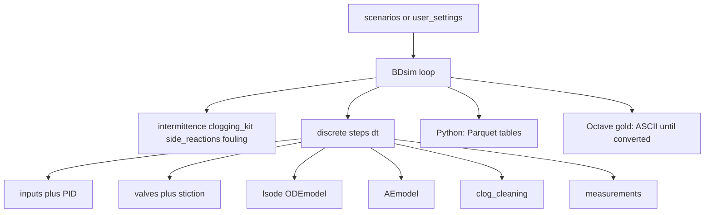

# BDsim Octave/MATLAB → Python port — execution handbook

> **Status (bdsim-python):** Core dynamics ported. Solver remains **RK45** (not LSODA).
> Final exports are **Parquet** (`bdsim.io_parquet`). Gold scenarios S00–S07:
> `python -m bdsim.scenarios` / `scripts/run_gold_scenarios_cluster.sh`.
> Reference ASCII: `data/results_octave/gold_dataset_1w/`. Parity tests: `tests/test_gold_parity.py`
> (tolerant RMSE). Details: `.cursor/Port_review.md`, `docs/30-engine/Gold-parity-cluster.md`.

How to port BDsim to Python while **preserving physical and chemical dynamics**, choosing equivalent libraries, writing **Parquet** results, and proving replication against Octave gold.

Companion docs:

- [`.cursor/simulation.md`](.cursor/simulation.md) — golden scenarios S00–S07, fingerprints, milestone order
- [`scenarios/GOLD_SCENARIOS.md`](scenarios/GOLD_SCENARIOS.md) — full parameter tables and explanations for each gold scenario
- [`scenarios/README.md`](scenarios/README.md) — how to run the Octave suite
- [`.cursor/rules/simulator-dynamics-frozen.mdc`](.cursor/rules/simulator-dynamics-frozen.mdc) — do not alter `simulator/` math unless explicitly asked

**Gold reference stack:** GNU Octave + `lsode` (batch runners / `run_scenario`). MATLAB + `ode45` is a secondary path, not the parity target.

---

## 1. Goals and non-goals

**Goals**

- Python trajectories that match Octave gold: `data/results_octave/gold_dataset_*/S##/` → `data/results_py/S##/` on `states`, `inputs`, `measurements`, `setpoints`, and `tclean` when present.
- Same phenomenological fingerprints as in `.cursor/simulation.md` §3 and [`tests/test_phenomenology.m`](tests/test_phenomenology.m).
- Python writes **Parquet** (`*.parquet`), not legacy ASCII (optional ASCII debug export only).

**Non-goals**

- Fault-detection research or redesigning kinetics / HX / filter physics.
- Bit-identical floats across every ODE solver or across MATLAB vs Octave.
- Changing equations or parameters under [`simulator/`](simulator/) “to make tests pass.”

---

## 2. Dynamics preservation (do not change)

Translate the following **literally** (`float64`, same constants and formulas). Configure only via settings mirrors of [`scenarios/`](scenarios/) / [`user_settings.m`](user_settings.m).

| Keep identical | Files |
|----------------|--------|
| Plant constants | [`simulator/system_parameters.m`](simulator/system_parameters.m) |
| ODE RHS | [`ODEmodel.m`](simulator/ODEmodel.m), [`ODEmodel_matlab.m`](simulator/ODEmodel_matlab.m) |
| Algebraic washer/dryer | [`AEmodel.m`](simulator/AEmodel.m) |
| Kinetics | [`rxrates.m`](simulator/rxrates.m), [`side_reactions.m`](simulator/side_reactions.m) |
| Properties / flow | [`Vmolar.m`](simulator/Vmolar.m), [`cpmx.m`](simulator/cpmx.m), [`Mmx.m`](simulator/Mmx.m), [`Qoil.m`](simulator/Qoil.m), [`split.m`](simulator/split.m) |
| Clogging / fouling | [`clogging.m`](simulator/clogging.m), [`clogging_kit.m`](simulator/clogging_kit.m), [`clog_cleaning.m`](simulator/clog_cleaning.m), [`fouling.m`](simulator/fouling.m) |
| Sensors / valves / PID formulas | [`measurements.m`](simulator/measurements.m), [`valves.m`](simulator/valves.m), [`stiction.m`](simulator/stiction.m), [`pid_controller.m`](simulator/pid_controller.m), [`inputs.m`](simulator/inputs.m) |

Do **not** “improve” numerics, rearrange stoichiometry, or retune `system_parameters` for the port.

---

## 3. Architecture map

Outer loop (fixed grid `t = ti:dt:tf`, control every `nic` steps): update inputs → valves → integrate ODE over `[t_{i-1}, t_i]` with held `u` → `AEmodel` → optional filter cleaning → measurements. See [`BDsim.m`](BDsim.m).

[`BDsim.m`](BDsim.m) is a **script** with workspace state; `inputs` / `pid_controller` / `valves` use **`persistent`**. In Python use a simulator class or `run_simulation(config)` with **explicit reset** between runs (equivalent to interactive `clear all`).

### Module → Python mapping

| Octave file | Role | Suggested Python |
|-------------|------|------------------|
| `system_parameters.m` | Plant constants `p`, `pp` | `parameters.py` / dataclass |
| `ODEmodel.m` | RHS `f(sv, t, p, u)` | `ode_model.py` |
| `ODEmodel_matlab.m` | `(t, sv)` wrapper | thin adapter if needed |
| `AEmodel.m` | Washer/dryer algebra | `ae_model.py` |
| `rxrates.m` | Arrhenius rates | `rxrates.py` |
| `side_reactions.m` | Scale `k0` | `side_reactions.py` |
| `split.m` | Light-phase NN split | `split.py` |
| `Vmolar` / `cpmx` / `Mmx` / `Qoil` | Properties / oil flow | `properties.py` |
| `clogging*` / `fouling` | Degradations | `clogging.py`, `fouling.py` |
| `inputs` / `pid_controller` | ARMAX + PID | `inputs.py`, `pid.py` (stateful) |
| `measurements` | 5 PVs + faults | `measurements.py` |
| `intermittence` | Random fault windows | `intermittence.py` |
| `valves` / `stiction` | Kano stiction | `valves.py`, `stiction.py` |
| `isOctave.m` | Platform detect | drop / unused in Python |
| `BDsim.m` | Orchestrator + I/O | `run.py` / `simulator.py` |

---

## 4. Equivalent packages / APIs

| Octave / MATLAB | Python | Notes |
|-----------------|--------|-------|
| arrays / `.*` | NumPy | Prefer `float64` |
| `lsode` | `scipy.integrate.solve_ivp(..., method="LSODA")` or `odeint` | Closest to ODEPACK / Octave gold |
| `ode45` | `solve_ivp(..., method="RK45")` | MATLAB path only — not gold target |
| `heaviside` (symbolic) | `numpy.heaviside(x, 1.0)` or `(t >= t0)` | Fix convention at `0` (0.5 vs 1) for fault edges |
| `rand` / `randn` + seed | `numpy.random.Generator` | Streams **differ** at the same seed — see §5 |
| `persistent` | Instance attributes | Reset between runs |
| `save -ascii` + `%` headers | **Parquet** via `pandas` + `pyarrow` | Named columns; see §6 |
| `pkg load symbolic` | N/A | Only for timed profiles in settings |

**Pinned deps:** `numpy`, `scipy`, `pandas`, `pyarrow` (optional `matplotlib` for overlays).

---

## 5. Differences we must expect

1. **Integrators** — Octave `lsode` ≠ SciPy `LSODA` / `RK45` step control. Expect small trajectory drift that grows with horizon and stiff clogging. Mitigate with tight `rtol`/`atol`, the **same outer `dt` grid**, and held inputs between steps (as in `BDsim.m`).
2. **MATLAB vs Octave already diverge** (`ode45` vs `lsode`). Python must match **Octave gold**, not MATLAB.
3. **RNG** — the same integer seed does **not** reproduce Octave `rand`/`randn` streams. For gold: keep `noise_std = 0` and `unoise_std = 0` (S00–S05, S07). For S06 intermittence: export Octave intermittence masks, reimplement Octave’s legacy RNG, or accept fingerprint-only comparison.
4. **`heaviside(0)`** — can shift fault on/off by one sample; document the Python convention in settings.
5. **Unit quirks to preserve** — pore radius is scaled to **µm** inside the ODE (driver `*1e6`); Octave ASCII header says `rpores/m` but values are µm. Parquet should use an honest name (e.g. `rpores_um`). Replicate **end-trim** of the last sample and the **`uv` one-step shift** before write or row alignment fails.
6. **1-based vs 0-based indexing** — `pvindex` / `uindex` / sensor columns in `.m` are 1-based; off-by-one bugs look like wrong loops or wrong PV faults.
7. **ASCII vs Parquet** — stop relying on line diffs. Compare DataFrames with numeric tolerances after converting Octave ASCII gold to Parquet (or loading ASCII into the same schema).

---

## 6. I/O and config parity (replication contract)

### Settings

Use the same `ti`, `tf`, `dt`, `nic`, `sv0`, `u0`, PID/ARMAX, `pfaults` / `sfaults` / `vfaults` as the golden scenarios (`dt = 30` s, week horizon unless smoke). See [`scenarios/README.md`](scenarios/README.md).

| Role | Directory |
|------|-----------|
| Octave gold | `data/results_octave/gold_dataset_1w/S##/` (ASCII) |
| Python | `data/results_py/S##/` (Parquet) |

### Unit conversions (must match `BDsim.m`)

**Into simulation:** Fmet kg/h → mol/s; Foil SP / PID / fault `b` kg/h → kg/s; pore radius m → µm.

**On write:** temperatures K → °C; Foil kg/s → kg/h; Fmet mol/s → kg/h.

### ASCII today (Octave reference)

| File | Columns |
|------|---------|
| `measurements` | `t`, `TR`, `TD`, `hH`, `Foil`, `DPfilter` (6) |
| `inputs` | `t`, oil-lift order, `Tmet`, `Fmet`, `Toil`, **`Qheat` (col 6)**, H-lift order (7) |
| `setpoints` | `t`, `sp1`…`sp4` (5) |
| `states` | `t` + 21 `sv` + 6 `xLend` + 6 `yLend` |
| `tclean.txt` | cleaning times (s), if any |

### Parquet target (Python — required)

Per scenario directory:

- `measurements.parquet`, `inputs.parquet`, `setpoints.parquet`, `states.parquet`
- `tclean.parquet` when cleanings occurred (column `t_s`); omit if empty

**Dtypes:** `float64`. **Compression:** `snappy` (document if you choose `zstd` instead).

**Stable column names** (snake_case):

**measurements:** `t_s`, `TR_C`, `TD_C`, `hH_m`, `Foil_kg_h`, `DPfilter_Pa`

**inputs:** `t_s`, `order_lift_oil_pct`, `Tmet_C`, `Fmet_kg_h`, `Toil_C`, `Qheat_W`, `order_lift_H_pct`

**setpoints:** `t_s`, `sp_TR_C`, `sp_TD_C`, `sp_hH_m`, `sp_Foil_kg_h`

**states:** `t_s`, then mirror BDsim headers with units in the name, e.g. `xR_TG`, `xR_DG`, `xR_MG`, `xR_M`, `xR_E`, `xR_G`, `TR_C`, `xL_*`, `xH_*`, `hH_m`, `TD_C`, `rpores_um`, `lifto_pct`, `liftH_pct`, `xDRY_*`, `yDRY_*`

Row count and `t_s` grid must match Octave **after** the same end-trim / `uv` shift.

### Comparison workflow

1. Run Octave → ASCII under `results_ref/S##/`.
2. Convert ASCII → Parquet (helper in the Python package; same schema as above).
3. Run Python → Parquet under `data/results_py/S##/`.
4. Load both with pandas/pyarrow; check column names, then RMSE / fingerprints.

---

## 7. Acceptance and milestone order

Follow [`.cursor/simulation.md`](.cursor/simulation.md) §§6–7:

1. **S00** — core dynamics + I/O (tight RMSE + regulation)
2. **S03** — side reactions / kinetics
3. **S02** — fouling
4. **S01** — clogging + cleaning (`tclean`)
5. **S04** — sensor fault calendar
6. **S05** — stiction
7. **S06–S07** — intermittence + combo (RNG strategy for S06)

**Smoke:** `./run_all_scenarios.sh SMOKE` (`BD_NPOINTS=100`) for wiring before full week.

**Short fingerprints** (from [`tests/test_phenomenology.m`](tests/test_phenomenology.m); reimplement reading Parquet):

| Check | Gate (starting point) |
|-------|------------------------|
| T00 / S00 regulation | After ~10% settle: mean \|TR−SP\|, \|TD−SP\| &lt; 5 K |
| T01 / S01 clogging | `max(DP) > DP[0]` and (`tclean` present or `max(DP) ≥ 0.9·DPclean`) |
| T02 / S02 fouling | Mean `Qheat` last 20% &gt; healthy baseline |
| T03 / S03 side rx | Mean \|xRE − xRE_healthy\| &gt; 1e−4 |
| T04 bias | In bias window, mean(meas TR − state TR) ≈ applied bias (±0.5 K) |

Tune RMSE bands on S00 once LSODE-like tolerances are fixed; fingerprints first, then tighter numeric gates.

---

## 8. Port checklist

1. Translate `system_parameters` (constants only — no edits to intent).
2. Translate property helpers + `rxrates` + `side_reactions` + `split`.
3. Translate `ODEmodel` (+ AE).
4. Translate measurements / faults / intermittence.
5. Translate PID + `inputs` + valves / stiction (stateful objects + reset).
6. Outer discrete loop + SciPy `LSODA`/`odeint` on each `[t_i, t_{i+1}]` with held `u`.
7. Replicate unit conversions, end-trim, `uv` shift.
8. **Parquet writer** (named columns, `float64`, snappy).
9. **ASCII→Parquet gold converter** for `data/results_octave/`.
10. Parity on **S00**, then S03 → S02 → S01 → S04 → S05 → S06–S07.
11. Decide S06 RNG strategy; document it.
12. CI: SMOKE + short phenomenology on Parquet.

---

## 9. References

- [`.cursor/simulation.md`](.cursor/simulation.md) — suite design and fingerprints
- [`scenarios/GOLD_SCENARIOS.md`](scenarios/GOLD_SCENARIOS.md) — per-scenario gold parameters
- [`scenarios/README.md`](scenarios/README.md), [`README.md`](README.md)
- [`BDsim.m`](BDsim.m), [`run_scenario.m`](run_scenario.m), [`tests/`](tests/)
- [`.cursor/rules/simulator-dynamics-frozen.mdc`](.cursor/rules/simulator-dynamics-frozen.mdc), [`.cursor/rules/matlab-octave-compat.mdc`](.cursor/rules/matlab-octave-compat.mdc)
- Physics / usage extracts (if present): `.cursor/knowledge/Fernandes2019.md`, `.cursor/knowledge/manual.md`
